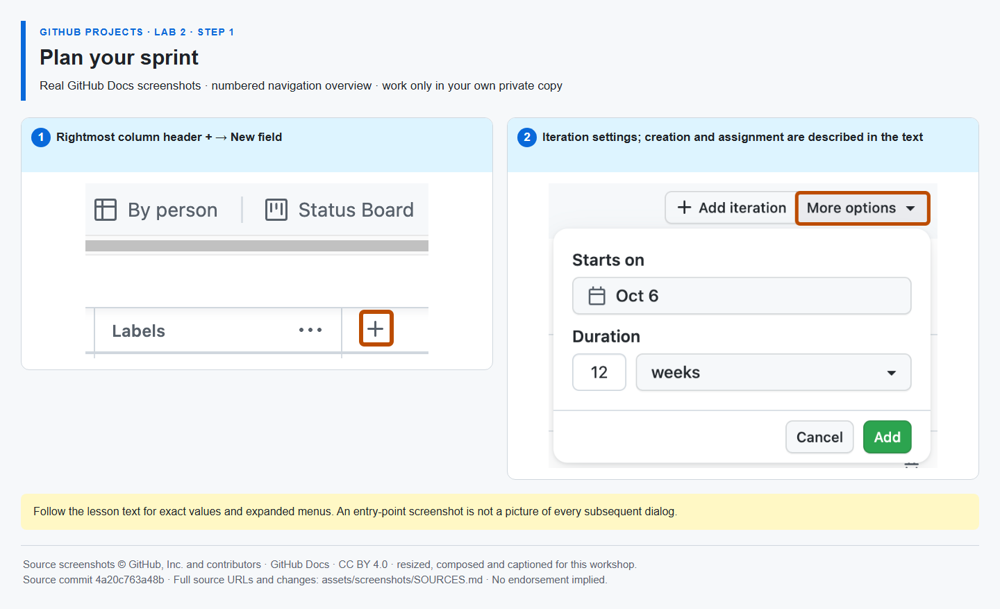
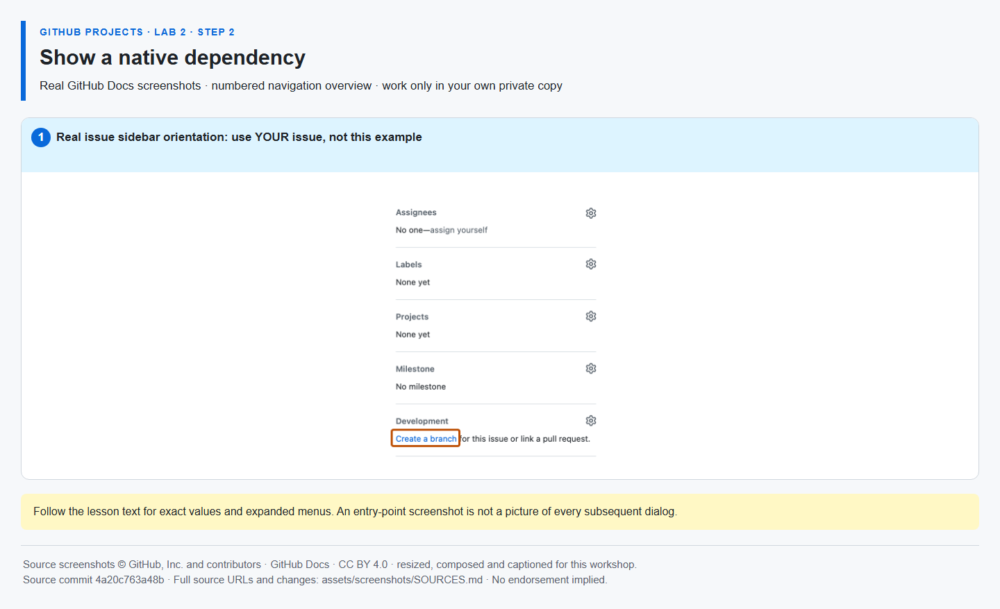
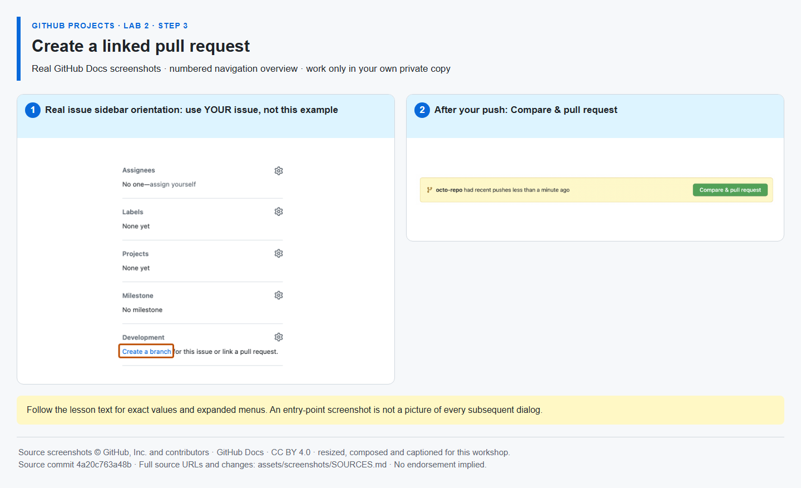
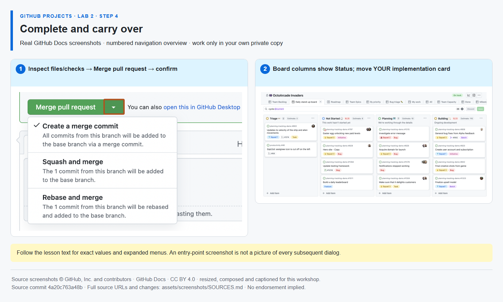

# GitHub Projects — Lab 2: plan and complete sprint work

> **[Continue in your existing Lab 1 private copy / Mona exercise; do not copy, fork or clone this companion.](https://github.com/alvine-aurelio-org/bsp-github-projects-lab-1)**
>
> This is a public **reference guide**, not a learner template. **Mona lives in your own existing Lab 1 copy**, in the exercise issue you already started. The link opens the public starter reference; return to your private copy to work. Never post completion commands or run source-repository Actions here.

## Welcome

- **Who is this for?** Project managers, product owners, team leads and developers who completed Lab 1 and have basic issue/PR familiarity.
- **What will you learn?** Sprint planning, native issue dependencies, a small local Git change, PR traceability, completion automation and carry-over.
- **What will you build?** A Sprint 1 plan and a real, one-file checklist PR, with unfinished verification retained for Sprint 2.
- **How long?** **35 minutes**, across the four steps below: 8 + 7 + 12 + 8.
- **Prerequisites:** your existing private Lab 1 repository, its local clone, its Mona exercise and the same private Project. Keep the five Backlog issues, numeric Effort values (implementation 3, verification 2), and the verification task unassigned. Use Git, PowerShell and VS Code or another editor, with your normal Git authentication. No personal access token, participant Node/npm, GitHub CLI, instructor account or paid add-on is required.

There are **three published repositories**, but each participant uses **one private repository and one private Project** for all three labs. Only Lab 1 is a starter. This companion has no Mona workflow, bootstrap or learner initialization.

Use the implementation issue **[Workshop] Publish the service release checklist** and verification issue **[Workshop] Verify the release checklist in Sprint 2** from your own copy. Mona's comments contain your actual issue numbers. Post each completion command as a **new comment in that same private Mona exercise issue**, not in a PR, a sample issue or either public source.

## Step 1 — Plan your sprint

**Time: 8 minutes · Topic: iterations and sprint commitment**

**Why:** an iteration is a timebox, unlike a repository milestone's release grouping. Planning on the existing Project keeps one source of truth.

**Do:**
- Open your Project's **Backlog**. Use the column-header **+ → New field**, name it **Sprint**, and choose **Iteration**. Start this week, with a one-week duration. Reuse an existing correctly typed Sprint field.
- Open Project **… → Settings → Sprint**. Name the first two consecutive, non-overlapping iterations **Sprint 1** and **Sprint 2**; add the second if needed.
- Return to Backlog. Put implementation and verification in **Sprint 1**. Open the view settings, **Group by → Sprint**, set **Field sum → Effort**, and save the view.

**Expected result:** Sprint 1 contains the two delivery tasks with total Effort **5**. This is relative size, not available working hours.



*Navigation reference: the iteration-settings overview does not show every initial field-creation dialog. Follow the controls above. [Image sources and modifications](assets/screenshots/SOURCES.md).*

**Complete in your private Mona exercise:**

```text
/done 2-1
```

**SELF-CONFIRMED:** Mona records your confirmation; it cannot inspect Sprint settings, Project membership or Effort totals.

## Step 2 — Show a native dependency

**Time: 7 minutes · Topic: blockers and delivery sequencing**

**Why:** a native dependency expresses sequencing. A body link, checkbox, label or custom Project field is not the native relationship, and a dependency does not enforce a merge gate.

**Do:**
- Open your **verification issue**, not the implementation issue. In the issue sidebar, open **Relationships → … → Mark as blocked by** (sometimes **Add blocked by**).
- Search for or paste the URL of your **implementation issue** and select it.
- Confirm verification shows **Blocked by → implementation**. Open implementation and inspect the reciprocal **Blocking → verification** relationship. Both issues must belong to your existing private repository; do not reverse the direction.

**Expected result:** verification is natively blocked by implementation, without duplicating either task.



*Navigation reference: this issue overview locates the sidebar; it does not display an expanded Relationships menu. Use the text above. [Image sources and modifications](assets/screenshots/SOURCES.md).*

**Complete in your private Mona exercise:**

```text
/check 2-2
```

**REPOSITORY-VERIFIED:** Mona reads GitHub's native issue-dependency endpoint. A body link or `/done 2-2` cannot pass. An unavailable or failed API check is not a pass.

## Step 3 — Create a linked pull request

**Time: 12 minutes · Topic: local Git, a one-file change and native issue linkage**

**Why:** a branch isolates the change; a PR lets you inspect it and link delivery to the real implementation issue. This solo activity is self-inspection, **not independent review or self-approval**.

**Do:** work only in the local clone of your **existing private Lab 1 copy**. Replace the repository placeholder below with that copy's actual **OWNER/REPOSITORY**, as shown in Mona's exercise. Paste each PowerShell group as a single block; it stops after a failed Git command. These commands do not change remotes or authentication settings.

```powershell
. {
    $expectedRepository = 'YOUR_OWNER/YOUR_PRIVATE_LAB1_REPOSITORY'
    if ($expectedRepository -eq 'YOUR_OWNER/YOUR_PRIVATE_LAB1_REPOSITORY') { throw 'Replace the placeholder with your existing private Lab 1 repository first.' }
    if ($expectedRepository -like 'alvine-aurelio-org/bsp-github-projects-lab-*') { throw 'This is a public source, not your private learner copy.' }
    $origin = git remote get-url origin
    if ($LASTEXITCODE -ne 0) { throw 'Cannot read origin; stop in the correct local clone.' }
    $allowedOrigins = @("https://github.com/$expectedRepository", "https://github.com/$expectedRepository.git", "git@github.com:$expectedRepository", "git@github.com:$expectedRepository.git")
    if ($origin -notin $allowedOrigins) { throw 'Origin does not match your private Lab 1 copy; stop without changing the remote.' }
    $pending = @(git status --porcelain=v1)
    if ($LASTEXITCODE -ne 0) { throw 'Cannot inspect the working tree.' }
    if ($pending.Count -ne 0) { throw 'Existing local changes found; preserve and resolve them before continuing.' }
    git fetch origin main
    if ($LASTEXITCODE -ne 0) { throw 'Fetch failed; resolve the displayed Git error using your normal sign-in.' }
    git switch -c workshop/release-checklist origin/main
    if ($LASTEXITCODE -ne 0) { throw 'Branch creation failed; do not continue on main or delete an existing branch.' }
}
```

In your editor, open **work/release-checklist.md** in that private clone. Change **only** the first checklist item to this exact line, leaving the Sprint 2 verification checkbox unchecked. Do not edit workflows, lessons or Mona's saved progress.

```markdown
- [x] Publish the service release checklist
```

Save, inspect and publish exactly that file:

```powershell
. {
    $branch = git branch --show-current
    if ($LASTEXITCODE -ne 0) { throw 'Cannot inspect the current branch.' }
    if ($branch -ne 'workshop/release-checklist') { throw 'Stop: the required work branch is not checked out.' }
    git diff --cached --quiet
    if ($LASTEXITCODE -ne 0) { throw 'Pre-existing staged changes found; preserve and resolve them before continuing.' }
    git diff -- work/release-checklist.md
    if ($LASTEXITCODE -ne 0) { throw 'Cannot inspect the checklist change.' }
    git add -- work/release-checklist.md
    if ($LASTEXITCODE -ne 0) { throw 'Staging failed.' }
    git diff --cached --check
    if ($LASTEXITCODE -ne 0) { throw 'Fix staged whitespace before committing.' }
    git diff --cached -- work/release-checklist.md
    if ($LASTEXITCODE -ne 0) { throw 'Cannot inspect the staged checklist.' }
    git commit -m "Publish the service release checklist"
    if ($LASTEXITCODE -ne 0) { throw 'Commit failed; resolve the displayed Git error.' }
    git push -u origin workshop/release-checklist
    if ($LASTEXITCODE -ne 0) { throw 'Push failed; do not use a different branch or public source.' }
}
```

Open **your private repository → Compare & pull request**. Base: **main**; compare: **workshop/release-checklist**. Title: **Publish the service release checklist**. Put this in the description, replacing **YOUR_IMPLEMENTATION_ISSUE_NUMBER** with your actual implementation issue number, keeping the `#`:

```text
Closes #YOUR_IMPLEMENTATION_ISSUE_NUMBER
```

Create the PR and confirm its **Development** relationship points to that issue. Inspect **Files changed**: only the checklist file may differ. **Keep the PR open until Mona confirms Step 2-3 passed and posts Step 4.** Do not close the implementation issue manually or change the checked PR head after it passes.

**Expected result:** an open PR, from the exact work branch into main in your own repository, with the single checked line and a native closing relationship to the actual implementation issue.



*Navigation reference: make the file edit locally; the browser is for opening and inspecting the PR. [Image sources and modifications](assets/screenshots/SOURCES.md).*

**Complete in your private Mona exercise:** replace **YOUR_PR_NUMBER** with this PR's actual number, not an issue number.

```text
/check 2-3 #YOUR_PR_NUMBER
```

**REPOSITORY-VERIFIED:** Mona checks author, same-repository head/base, exact branch, the native closing relationship, the only changed file and the required checked line. It does not award independent review or approval.

## Step 4 — Complete and carry over

**Time: 8 minutes · Topic: merge traceability, built-in automation and unfinished work**

**Why:** merging a closing PR into the default branch closes its issue. A Project workflow can separately set Status to Done; unfinished verification must remain visible.

**Do:**
- Only after Mona's Step 2-3 pass, open your Project **… → Workflows** and enable **Item closed → Status: Done**. Return to the same PR, inspect **Files changed**, and wait for **Workshop verification** to pass. Do not alter the checked head.
- Select **Merge pull request → Confirm merge**, or the permitted squash option, into **main**. No approval is required in the personal sandbox; this is **not independent review or self-approval**. Respect inherited organizational protections rather than disabling them.
- Confirm implementation closed as completed and its Project item becomes **Done**. Keep implementation in **Sprint 1**. Keep verification **open**, move only its Sprint value to **Sprint 2**, and save any view changes.

**Expected result:** implementation issue → work branch → PR → merge → closed issue, plus a Done Project item. Verification remains open in Sprint 2. Issue state and Project Status are separate values.



*Navigation reference: the overview shows entry points, not proof of your own merge or carry-over. Use your actual Sprint field. [Image sources and modifications](assets/screenshots/SOURCES.md).*

**Complete in your private Mona exercise:** use the same actual PR number checked in Step 3.

```text
/check 2-4 #YOUR_PR_NUMBER
```

**MIXED EVIDENCE:** Mona verifies the same checked PR/head, merge into main, native issue link, implementation closure, open verification and merged checklist. Submitting the command **self-confirms** Project Done and Sprint 2 carry-over; Mona cannot inspect those fields. It posts Lab 3 in the same exercise issue.

## Troubleshooting

- **No Mona here:** expected. This public companion is reference only. Return to the existing exercise in your private Lab 1 copy; `/status` and `/help` are safe there. Use only a new comment from the learner who started it.
- **Missing Sprint controls:** check the field is Iteration, use Project settings and save the view. A Project permission or feature limitation is not completed work; do not self-confirm it.
- **Dependency check fails:** use the verification issue's native Relationships menu, select implementation in the same repository and retry `/check 2-2`. A written issue link is insufficient; API failures earn no progress.
- **Wrong origin, dirty tree or branch already exists:** stop. Return to the correct private clone, inspect and preserve existing work, and resume the existing intended branch only when its base and changes are understood. Do not reset, force-push, delete a branch or change a remote to make a command pass.
- **Git sign-in or author error:** use your own normal Git sign-in and, if needed, repository-local author name/email. Never use an instructor identity or paste credentials into files, command comments or public issues.
- **PR check fails:** keep the PR open, use the actual PR and implementation numbers, exact branch and one-file diff, correct the displayed problem, and submit a fresh check. Do not merge before Step 2-3 passes or alter its head afterward.
- **A reviewer is required:** that managed environment has an extra prerequisite. Respect the policy and obtain its authorized review; do not call author self-inspection an approval or disable protections.
- **Done did not update:** inspect Item closed automation and the Project card yourself. A successful repository check is not evidence that Mona read a Project field.

## Safety and evidence

Use synthetic training tasks only, never real BSP data or original BSP documents. Keep exports and account screenshots local. No new repository, Project, credential or service is needed. The companion's author checks validate static content, not your private Project, live GitHub access or an independently reviewed assessment.

## Author verification

Learners do not install tooling here. Authors need **Node 22+**, with no npm dependencies: `npm test` runs the built-in test runner and `npm run verify` runs [tools/verify-content.mjs](tools/verify-content.mjs). Both require the four actual PNGs and linked attribution files; missing assets fail rather than being replaced with placeholders. These are offline publication checks, not Mona completion commands or a live UI rehearsal.

## License and acknowledgements

Workshop text and code: [MIT](LICENSE). Reused GitHub Docs screenshot material is separately [CC BY 4.0](https://creativecommons.org/licenses/by/4.0/); see [THIRD-PARTY-NOTICES.md](THIRD-PARTY-NOTICES.md) and [image sources](assets/screenshots/SOURCES.md). Inspired by [GitHub Skills](https://skills.github.com/), but independently authored, not an official GitHub Skills course and not endorsed by GitHub or BSP. [Security and privacy](SECURITY.md).
